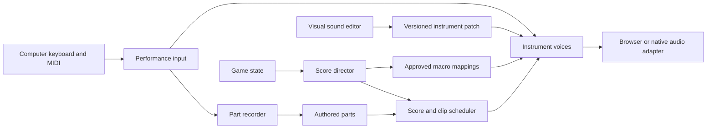

# Visual instrument design and keyboard authoring for Way

Research date: November 2, 2026. Original analysis and proposed design: MIT.

Way should let composers play and preserve their own melodies, countermelodies, riffs, bass hooks, and signature sounds. The most useful precedent from modern production software is a short, reversible loop: play a phrase, change the sound while hearing the phrase, compare alternatives, and save both the musical part and the instrument. Visual synthesis, expressive input, and a small set of meaningful performance controls make a deep instrument approachable.

The direction is three connected workspaces: **Perform**, **Sound**, and **Game**. Authored parts and instrument patches remain separate portable assets. Procedural systems arrange the parts and move approved sound controls; they do not replace recognizable hooks. Version 0.6 implements the initial authoring workflow described in [the studio guide](authoring-studio.md); the broader synthesis and portability proposals below remain the research roadmap.

## What current tools make easy

| Reference | Documented workflow | Useful pattern for Way |
| --- | --- | --- |
| [Vital](https://vital.audio/) | Animated waveforms, filter responses, envelopes, LFOs, scopes and spectrograms; drag-and-drop modulation with a preview; custom wavetable creation and sample conversion. | Make the relationship between a gesture and its sound visible. Preview a route before committing it. |
| [Serum 2](https://xferrecords.com/web-manual/serum-2/welcome) | Wavetable, subtractive, sample, multisample, granular and spectral engines in one instrument. Its [sample conversion workflow](https://support.xferrecords.com/article/59-converting-samples-to-wavetables) turns a sample into wavetable frames. | Let users start from a simple oscillator or an owned recording and refine it without changing their notes. |
| [Sytrus](https://www.image-line.com/fl-studio-learning/fl-studio-online-manual/html/plugins/Sytrus.htm) | Customizable operators, FM and other synthesis methods, an editable harmonic spectrum, envelopes, and an effects section. | Offer harmonic bars as an alternative to drawing a waveform; show a simpler performance surface before deeper synthesis controls. |
| [Ableton Live keyboard input](https://www.ableton.com/en/manual/routing-and-i-o/#playing-midi-with-the-computer-keyboard) | Computer keys play a piano layout, with separate octave and velocity controls. Hardware MIDI input and remote mappings have distinct roles. | Make playing possible immediately, while separating musical notes from control shortcuts. |
| [Ableton Instrument Racks](https://www.ableton.com/en/manual/instrument-drum-and-effect-racks/) | Several device parameters can map to one macro with bounded or inverted ranges. Macro states can be saved as variations; selected controls can be excluded from randomization or variation recall. | A few named controls can expose a complex sound to a performer or a game without exposing every internal parameter. |
| [Bitwig Grid](https://www.bitwig.com/userguide/latest/special_connections/) | Common pitch and gate connections are available as built-in connections called pre-cords. Users can override defaults rather than manually wire everything. | Start with an instrument that already plays. Offer advanced routing when users need it. |

Serum also makes [undo and redo](https://xferrecords.com/web-manual/serum-2/undo-and-redo) part of experimentation and supports [embedding eligible sample or wavetable content in a preset](https://xferrecords.com/web-manual/serum-2/embedding-content-when-saving-a-preset). These are consequential workflow features: experiments need a path back, and a shared patch needs its external assets. Its factory-content embedding restriction is also a reminder that a preset file does not necessarily contain freely redistributable source material.

Ableton's [custom wavetable documentation](https://help.ableton.com/hc/en-us/articles/360002719179-User-Wavetables) describes drag-and-drop audio import, cycle preparation, phase alignment, and project asset collection. The design lesson is to make import preparation understandable and preserve the original. Different synthesizers use different frame conventions; an arbitrary WAV is not automatically a portable wavetable.

## What Porter Robinson describes about signature sounds

In his [Image-Line artist interview](https://www.image-line.com/artists/porter-robinson), Robinson describes programming bass sounds with Sytrus and 3xOSC, manually sequencing vibrato through piano-roll slides, valuing visual EQ, and editing audio in Edison. This describes that period of his work, rather than establishing his current plugin list. For Way, the important connection is between sound design, note expression, and editing: the distinctive result is not confined to the oscillator.

In a [September 2020 Atwood interview](https://atwoodmagazine.com/pbmi-porter-robinson-interview-2020/), he describes discovering the pitched-up vocal character of *Nurture* through experimentation and recognizing that it could become a repeatable signature. In the [Song Exploder transcript for Get Your Wish](https://songexploder.net/transcripts/porter-robinson-transcript.pdf), he discusses a piano idea, a sound made by setting his phone on the piano that became part of the groove, and pitch processing that helped him express himself vocally.

The design implication is to support capturing discoveries and returning to them. A signature instrument might combine synthesis, a recording, a characteristic attack, pitch gestures, and effects. Way should preserve the patch, its assets, and the expressive performance together without making them inseparable. These accounts support creative workflows, not an exact reconstruction of his patches or a claim that he uses a particular modern wavetable synth.

## What the visual instrument editor should explain

An instrument patch contains more than a waveform. A useful initial signal path is oscillators or samples into a filter, then an amplitude envelope and effects. Modulation changes selected parameters over time. A waveform view, spectrum view, and envelope view answer different questions and should use labeled axes.

| Visual tool | What the user edits or observes | Proposed interaction |
| --- | --- | --- |
| Single-cycle waveform | Amplitude across one repeating cycle | Draw a shape, use basic shapes, smooth it, and compare with the previous version. |
| Harmonic editor | Strengths and optionally phases of integer harmonics | Paint harmonic bars while seeing the corresponding waveform. Start with a manageable number of visible harmonics. |
| Wavetable frames | A sequence of cycles through which the sound can move | Edit frames, preview interpolation, and animate the current position while notes play. |
| Amplitude envelope | Attack, decay, sustain level, release | Drag a curve with explicit time and level units; show its current playback phase. |
| Filter view | Frequency response and resonance | Drag cutoff and resonance; show the base setting and the modulated movement separately. |
| LFO and modulation routes | Repeated movement of another control | Draw a curve, choose free time or tempo sync, and drag it to a destination with a visible depth range. |
| Output scope and spectrum | The resulting signal and its frequency content | Inspect the sound after processing. These displays observe the result; they are distinct from the source editor. |

Subtractive synthesis starts with a harmonically rich source and shapes it with filtering. Additive synthesis builds a sound from partials. FM changes one oscillator's frequency using another signal, with pitch relationships and modulation depth affecting the result. Wavetable synthesis scans between repeating cycles. Sampling plays a recording; granular techniques rearrange small portions of it. These methods can be combined, but a first editor does not need all of them to be useful. The [Sytrus manual](https://www.image-line.com/fl-studio-learning/fl-studio-online-manual/html/plugins/Sytrus.htm) provides concrete examples of harmonic editing, operator routing, and waveform preparation.

For Way, begin with two oscillators, basic shapes and harmonic editing, an amplitude envelope, a filter envelope, one LFO, and a short effects chain. Add a few authored wavetable frames once the playback and editing model is solid. Keep the recorded orchestral bank available as another instrument source. Later additions can include richer FM routing, sample-to-wavetable conversion, granular textures, and a modular graph.

Waveform preparation needs attention to cycle boundaries, DC offset, levels, and aliasing across the instrument's range. A shape that looks smooth at one pitch may not behave well higher up. Sytrus explicitly provides band limiting and declicking controls; those are examples of audio quality work beneath the visual surface. Audition low, middle, and high notes and edits made while a note is held.

## Perform workspace

The main actions should be **Play**, **Record**, **Keep take**, and **Edit part**. Keep the selected instrument and an on-screen keyboard visible. Allow the composer to loop their own phrase while adjusting its sound, and to switch between melody and countermelody without reopening the instrument editor.

### Computer keyboard and hardware input

A familiar proposed US keyboard layout is `A S D F G H J K` for `C D E F G A B C`, with `W E T Y U` for the intervening black keys. Use `Z/X` for octave changes and `C/V` for audition velocity, with visible labels and remapping. This follows the general approach documented in [Ableton's keyboard workflow](https://www.ableton.com/en/manual/routing-and-i-o/#playing-midi-with-the-computer-keyboard). Ordinary typing keys do not provide strike velocity; use a selected value rather than pretending they do.

Provide an explicit performance-mode toggle. Do not consume music keys while the user is editing text, and do not let browser key-repeat create repeated note attacks. Track each pressed key until release, remembering the pitch assigned at press time even if the octave changes. Release held voices on focus loss, device removal, and performance-mode exit. Supply a visible all-notes-off control. A MIDI keyboard provides a better route for expressive chords when a typing keyboard's simultaneous-key limits become restrictive.

Offer mouse and touch playing plus optional hardware MIDI selection. Start with notes, velocity, sustain, pitch bend, and a mod-wheel macro. Support assigning a hardware control through a **Learn** action. Treat expressive controllers and MPE as a later capability with explicit per-note routing semantics, rather than treating all pressure messages as interchangeable.

Web MIDI currently has limited browser availability, requires a secure context, and requires granted device access. Keep computer and on-screen input available when it is absent or denied. [Browser platform documentation](https://developer.mozilla.org/en-US/docs/Web/API/Web_MIDI_API). The hardware controller supplies musical messages; the synth still supplies audio.

### Recording and editing authored hooks

Record note starts, releases, velocity, and expression into named parts: melody, countermelody, bass hook, riff, or another user label. Keep the original take. Quantization, scale assistance, transposition, and duration changes should be explicit reversible edits. Scale assistance is optional because borrowed notes and chromatic gestures may be essential to the hook.

Provide overdub and replacement as distinct choices, a count-in, loop recording, and a step-input option for composers who prefer entering one event at a time. A piano roll should show the other authored parts as subdued reference notes, with editable velocity and pitch-expression lanes. This brings melodic and counter-melodic relationships into one view without forcing them into one instrument.

Store time in ticks with PPQ and a meter map. Preserve pickups, rests, overlapping notes, phrases crossing bar lines, and a loop end independent of the final note's release. In a 7/8 to 5/8 to 4/4 sequence, bar lines organize the view; they should not silently stretch or truncate the hook. Let the composer supply alternate meter versions or explicitly authorize a transformation.

## Sound workspace

Open with a useful playing patch, not an empty graph. Put oscillator shape, envelope, filter, and a few macros in the first view. Deeper modulation appears when selected. Bitwig's defaults and Vital's visible modulation provide different precedents for reducing setup while retaining depth.

Keep a small phrase loop and keyboard available while editing. Offer A/B comparison, undo, save as a new revision, and a return to the saved patch. Preserve an initialized patch for learning and named original recipes such as a plucked bell, airy pad, restrained bass, or bright lead. Preview each across the intended range; a single impressive note can conceal problems elsewhere.

Sound exploration may include bounded randomization of unlocked parameters. Lock the oscillator source, envelope, effects, or other identity-bearing controls independently. Accepting a variation creates a new patch revision; it must not rewrite the authored melody or countermelody. The generator can propose a sound variant while the composer decides which discoveries become canonical.

Use macros with descriptive names such as **Brightness**, **Motion**, **Width**, and **Space**, but let authors rename and define them. Each mapping needs a destination, range, direction, curve, and smoothing. For example, Brightness might move filter cutoff and wavetable position together over limited ranges. Audible results depend on the patch; a macro label is not a universal acoustic measurement. Ableton's [macro mapping and variation controls](https://www.ableton.com/en/manual/instrument-drum-and-effect-racks/#using-the-macro-controls) provide the precedent for grouping controls, bounding their ranges, and recalling states.

## Game workspace

The composer should map gameplay variables to approved macros and arrangement choices. An opening might recall a restrained patch variation; movement might increase Motion slightly; danger might increase pulse and Brightness within authored bounds. The melody and countermelody remain the user's material. A narrative cue can choose another authored part or variation without mutating the source.

Show the source value, its smoothed value, mapped controls, and audible result during preview. Include a manual telemetry simulator so the composer can audition title, control, travel, danger, loss, and resolution without running a game. Allow individual mappings to be bypassed and compare them against the base patch.

Keep timing rules distinct. A sound macro can move continuously with smoothing. A clip launch or arrangement change can wait for a beat or phrase. Live note input should sound promptly and independently of the next-bar policy. A game developer should not have to express every change as a replacement score.

## Portable data and audio architecture

| Portable asset | Required meaning |
| --- | --- |
| Authored part | Note and expression events, timing units, meter context, loop boundaries, identity, revision, and allowed transformations. |
| Instrument patch | Source types, oscillator settings, envelope behavior, filters, effect order, voice behavior, modulation, macros, and DSP version. |
| Audio or wavetable asset | Frame/sample conventions, tuning where relevant, hash, source, author, license, and redistribution status. |
| Game mapping | Input range, target macro or arrangement, bounds, smoothing, priority, and timing policy. |
| Performance binding | Device/key assignment and controller mapping, stored separately from the musical part. |

A JSON patch alone does not guarantee that two engines sound the same. Define envelope curves, oscillator phase behavior, modulation scaling, filter interpretation, sample-rate handling, voice allocation, and effect algorithms. Use a reference renderer and shared test fixtures. Other hosts can report unsupported capabilities instead of silently replacing a signature sound.

The browser already offers custom oscillator shapes through [PeriodicWave](https://developer.mozilla.org/en-US/docs/Web/API/PeriodicWave). More demanding custom synthesis can run in [AudioWorklet](https://developer.mozilla.org/en-US/docs/Web/API/AudioWorklet), which processes audio on a separate Web Audio thread. Waveform drawing and UI animation should not run the audible clock. A first implementation can use existing Web Audio nodes while preserving portable patch definitions; profile before introducing a more complex backend.

[Faust](https://faustdoc.grame.fr/manual/introduction/) is worth a focused backend experiment because it targets multiple implementation environments; its [web deployment tools](https://faustdoc.grame.fr/manual/deploying/) generate WebAssembly-backed Web Audio nodes and support polyphonic and offline scenarios. Test a small reference instrument for browser/native consistency before choosing it. No Faust integration or Unreal playback is implied by this research.

## Current Way readiness

Inspection of [the browser player](../src/browser-player.mjs), [renderer](../src/webaudio.mjs), and [transport](../src/transport.mjs) shows reusable audio lifecycle, scheduled score playback, recorded samples, basic oscillator timbres, filters, envelopes, and room processing. The current UI has no authored-parts recorder, keyboard note input, wavetable editor, or portable synth-patch editor. The renderer's principal interface schedules a note with a known duration; interactive note-on and later note-off need an explicit voice interface.

The present score director applies many changes at musical boundaries, while the transport schedules ahead. Do not route keyboard presses through `setState` and wait for the next bar. Add a performance path that starts and releases identified voices on the audio timeline, while the recorder independently maps performance times into score ticks. Meter and tempo changes require a consistent time mapping during capture.

## Implementation sequence and acceptance criteria

1. **Play and preserve a hook.** Computer and on-screen keyboard, optional MIDI input, immediate note-on/off, record into separate authored parts, save/reload, and reversible editing. Held notes release correctly after focus changes and overlapping input. Replaying a saved take preserves its notes, rhythm, rests, and expression within the declared format's precision.
2. **Design and save an instrument.** Two oscillators, waveform/harmonic editing, envelopes, filter, one LFO, visible routing, useful effects, undo/A-B, and a versioned patch. Waveform changes are auditionable across the range without leaving the part editor. Saving and reloading preserves the patch and resolves its assets.
3. **Expose expressive variation.** Named macros, bounded mappings, patch variations, MIDI Learn, and gameplay preview. A game can move approved macros without changing a protected hook. Repeated events and held notes behave predictably during patch changes.
4. **Expand synthesis and portability.** Wavetable frame import and morphing, richer FM/sample processing, a measured AudioWorklet or shared-DSP backend, and native integration. Verify browser/native behavior with the same parts and patches before claiming parity.

Measure perceived responsiveness and end-to-end input-to-sound latency on target devices rather than promise a universal number. Check typing-key chords, MIDI disconnection, sustain, repeated pitches, meter changes during capture, bounded polyphony, UI activity during playback, and live/offline rendering. Preserve authored notes when the user is exploring timbre; that is the central acceptance requirement.

## Licensing and reuse choices

Use these commercial products as workflow references rather than runtime dependencies. Do not copy their interface artwork, factory presets, or wavetable banks. A user supplying an instrument asset needs to be able to record its origin and permitted redistribution separately from Way's MIT code.

Vital's [upstream repository](https://github.com/mtytel/vital) identifies GPLv3 source licensing, offers a non-GPL licensing contact, and explicitly says its free-version presets have separate terms that do not allow redistribution. Forking its engine into Way therefore needs a different integration/licensing decision; free access to the application does not make its code or assets MIT.

The [Faust licensing FAQ](https://faustdoc.grame.fr/manual/faq/#what-is-the-situation-about-faust-compiler-licence-and-the-deployed-code) distinguishes the compiler's LGPL from generated output and requires checking the input libraries and architecture files. It is a candidate, not a blanket MIT clearance. Review pinned files and notices if selected.

This update includes original research prose and design proposals only. It adds no third-party source, patches, recordings, or dependency. The existing MIT software, CC0 instrument recordings, and separately CC BY-SA theory document retain their current scopes.
